# Guía de la clase: React básico (componentes, hooks y rutas)

> Esta guía resume **todo lo que hicimos en clase**, explica **para qué sirve cada cosa**, **cuándo te conviene usarla**, **qué alternativas existen** y **dónde está la documentación oficial**.
> Al final hay un **ejercicio obligatorio** para construir una landing page paso a paso.
>
> Regla de oro de esta guía: **PASO → PRUEBA → PASO → PRUEBA.**
> Nunca escribas 50 líneas seguidas sin mirar el navegador. Si algo se rompe, sabrás que fue lo último que tocaste.

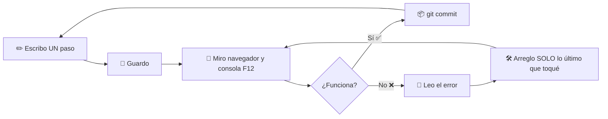

> 🖼️ **Sobre los diagramas:** esta guía usa diagramas **Mermaid**. En **GitHub** se ven como dibujos automáticamente. En **VS Code**, instala la extensión *Markdown Preview Mermaid Support* y abre la vista previa con `Ctrl + Shift + V`.

---

## Índice

1. [Cómo arrancar este repositorio](#1-cómo-arrancar-este-repositorio)
2. [Qué se instaló y por qué](#2-qué-se-instaló-y-por-qué)
3. [Mapa del proyecto](#3-mapa-del-proyecto)
4. [Conceptos vistos en clase](#4-conceptos-vistos-en-clase)
   - 4.1 Componentes y JSX
   - 4.2 Fragments `<> </>`
   - 4.3 Props (y su `interface` en TypeScript)
   - 4.4 `useState`: el estado
   - 4.5 Eventos (`onClick`)
   - 4.6 Renderizado condicional
   - 4.7 Listas con `.map()` (y la `key`)
   - 4.8 Pasar funciones al hijo (“levantar el estado”)
   - 4.9 Servicios: funciones fuera del componente
   - 4.10 Imágenes y CSS (Bootstrap)
   - 4.11 React Router: páginas, `Outlet`, `Link`, 404
   - 4.12 `useNavigate`, `useLocation` y `useEffect`: redirecciones
   - 4.13 `StrictMode`
5. [Cómo romper la app (a propósito) y arreglarla](#5-cómo-romper-la-app-a-propósito-y-arreglarla)
6. [Documentación oficial](#6-documentación-oficial)
7. [EJERCICIO: Landing page paso a paso](#7-ejercicio-landing-page-paso-a-paso)
8. [Checklist de entrega](#8-checklist-de-entrega)

---

## 1. Cómo arrancar este repositorio

Necesitas tener instalado **Node.js** (versión LTS). Compruébalo en la terminal:

```bash
node -v
npm -v
```

Si ambos muestran un número de versión, estás listo. Si no, descárgalo de <https://nodejs.org>.

Después de clonar o descargar el repo:

```bash
npm install     # descarga todas las dependencias (crea la carpeta node_modules)
npm run dev     # levanta el servidor de desarrollo
```

Abre la URL que te muestra la terminal (normalmente `http://localhost:5173`).

### ¿Por qué tengo que hacer `npm install` si ya descargué el proyecto?

Porque la carpeta `node_modules` (donde viven React, Router, Bootstrap...) **NO se sube a GitHub**: pesa muchísimo y se puede regenerar. Mira el archivo `.gitignore`: ahí dice `node_modules`.
Lo que sí se sube es `package.json`, que es la **lista de la compra**: `npm install` lee esa lista y descarga todo.

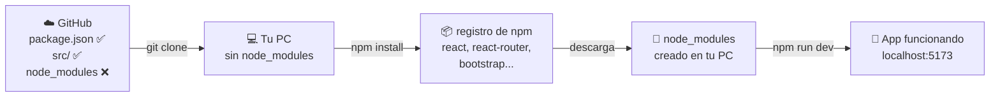

### Comandos del proyecto (están en `package.json` → `"scripts"`)

| Comando | Qué hace | Cuándo usarlo |
|---|---|---|
| `npm run dev` | Servidor de desarrollo con recarga automática (HMR) | Siempre mientras programas |
| `npm run build` | Revisa los tipos de TypeScript y genera la versión final en `dist/` | Antes de entregar o publicar |
| `npm run preview` | Sirve la carpeta `dist/` para ver cómo quedaría publicada | Después del build |
| `npm run lint` | Busca errores y malas prácticas con ESLint | Antes de hacer commit |

> 💡 Para parar el servidor: `Ctrl + C` en la terminal.

---

## 2. Qué se instaló y por qué

### Creación del proyecto

```bash
npm create vite@latest clase_react -- --template react-ts
```

- **Vite**: es la herramienta que arranca el servidor de desarrollo y empaqueta la app. Es muy rápida y es la forma recomendada hoy para empezar un proyecto React “a mano”.
- **`react-ts`**: plantilla de React con **TypeScript** (JavaScript con tipos; te avisa de errores antes de ejecutar).

### Dependencias (`dependencies`): las que usa la app cuando funciona

| Paquete | Para qué sirve | ¿Por qué hace falta? |
|---|---|---|
| `react` | La librería: componentes, hooks (`useState`, `useEffect`...) | Sin esto no hay React |
| `react-dom` | “Dibuja” los componentes en el navegador (`createRoot`) | React por sí solo no sabe de HTML; `react-dom` es el puente |
| `react-router` | Navegación entre páginas sin recargar | React no trae rutas de serie |
| `bootstrap` | Estilos CSS ya hechos (botones, grid, navbar...) | Para no escribir todo el CSS desde cero |

Se instalaron así:

```bash
npm install react-router
npm install bootstrap
```

### Dependencias de desarrollo (`devDependencies`): solo para programar

| Paquete | Para qué sirve |
|---|---|
| `vite`, `@vitejs/plugin-react` | Servidor de desarrollo y build |
| `typescript`, `@types/react`, `@types/react-dom`, `@types/node` | Tipos: el editor sabe qué propiedades existen y te avisa si te equivocas |
| `eslint` y sus plugins | Revisa tu código. `eslint-plugin-react-hooks` avisa si usas mal los hooks |
| `babel-plugin-react-compiler`, `@rolldown/plugin-babel`, `@babel/core` | El **React Compiler**: optimiza automáticamente los componentes (configurado en `vite.config.ts`). No tienes que hacer nada, solo saber que está ahí |

> `npm install paquete` → va a `dependencies`.
> `npm install -D paquete` → va a `devDependencies`.

---

## 3. Mapa del proyecto

```
clase_react/
├── index.html              ← la ÚNICA página HTML. Tiene <div id="root">
├── package.json            ← lista de dependencias y scripts
├── vite.config.ts          ← configuración de Vite (+ React Compiler)
└── src/
    ├── main.tsx            ← PUNTO DE ENTRADA: crea el router y monta la app en #root
    ├── App.tsx             ← componente “layout”: header + <Outlet/> + footer
    ├── index.css           ← estilos globales (aquí se importa Bootstrap)
    ├── App.css             ← estilos de App
    ├── assets/             ← imágenes (pc.webp, hero.png...)
    ├── components/
    │   ├── img.component.tsx      ← estado, props, listas, condicionales, eventos
    │   ├── nombre.component.tsx   ← componente simple
    │   ├── hijo.component.tsx     ← useLocation + useNavigate + useEffect (redirección)
    │   └── hermano.component.tsx  ← página vacía (destino de la redirección)
    └── services/
        └── funciones.service.ts   ← funciones reutilizables (lógica fuera de los componentes)
```

### ¿Cómo fluye la app? (el orden en que pasan las cosas)

1. El navegador abre `index.html`, que tiene un `<div id="root"></div>` vacío y carga `src/main.tsx`.
2. `main.tsx` crea el **router** (las rutas) y le dice a React: “dibuja todo dentro de `#root`”.
3. El router mira la URL:
   - `/` → dibuja `App`.
   - `/hijo` → dibuja `App` y, **dentro de su `<Outlet />`**, dibuja `Hijo`.
   - `/hermano` → dibuja `App` y dentro `Hermano`.
   - cualquier otra cosa (`*`) → “not found”.
4. `App` dibuja el header con los `Link`, el `Outlet` y el componente `Img`.

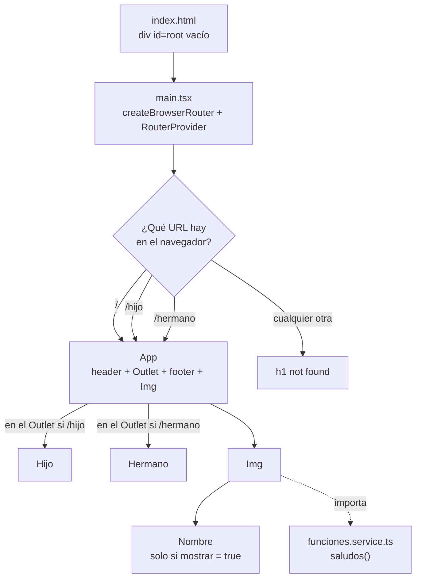

**Árbol de componentes** (quién está dentro de quién) cuando la URL es `/hijo`:

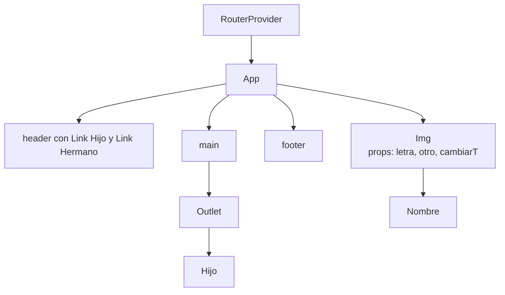

---

## 4. Conceptos vistos en clase

Cada concepto tiene: **qué es → ejemplo de clase → para qué sirve → cuándo usarlo → alternativas → docs.**

### 4.1 Componentes y JSX

**Qué es:** un componente es **una función que devuelve HTML** (en realidad JSX: HTML dentro de JavaScript).

```tsx
// src/components/nombre.component.tsx
export function Nombre() {
  return <h1>Fernando</h1>;
}
```

Y se usa como si fuera una etiqueta HTML: `<Nombre />`.

**Reglas que NO se pueden romper:**
- El nombre empieza con **Mayúscula** (`Nombre`, no `nombre`). Si va en minúscula React cree que es una etiqueta HTML.
- Se escribe `className` en vez de `class`, y `htmlFor` en vez de `for`.
- Todas las etiquetas se cierran: ``, `<hr />`, `<br />`.
- Para meter JavaScript dentro del JSX se usan llaves: `<h2>{contador}</h2>`.
- Los comentarios dentro del JSX: `{/* comentario */}`.

**Para qué sirve:** dividir la página en piezas pequeñas y reutilizables (Navbar, Card, Footer...).
**Cuándo usarlo:** siempre que un trozo de interfaz se repita o cuando un archivo crezca demasiado.
**Alternativas:** los componentes de clase (`class X extends React.Component`) existen pero están en desuso; hoy se usan funciones.
**Docs:** <https://es.react.dev/learn/your-first-component> · <https://es.react.dev/learn/writing-markup-with-jsx>

---

### 4.2 Fragments `<> </>`

Un componente **solo puede devolver UN elemento padre**. Si quieres devolver varios sin meter un `<div>` extra, usas un fragment:

```tsx
return (
  <>
    <h1>Título</h1>
    <p>Texto</p>
  </>
);
```

**Cuándo usarlo:** cuando no quieres ensuciar el HTML con `div` innecesarios.
**Docs:** <https://es.react.dev/reference/react/Fragment>

---

### 4.3 Props (y su `interface` en TypeScript)

**Qué es:** las props son los **parámetros** que el padre le pasa al hijo. Van en una sola dirección: **padre → hijo**.

En clase, `App` le pasa datos a `Img`:

```tsx
// App.tsx (padre)

```

```tsx
// img.component.tsx (hijo)
interface estructura {
  letra?: string;                         // el ? significa OPCIONAL
  otro: string;                           // obligatorio
  cambiarT: (parametro: string) => void;  // una función
}

export function Img(valor: estructura) {
  return <h2>{valor.letra}</h2>;
}
```

La `interface` es el **contrato**: dice qué props acepta el componente. Si te olvidas de pasar `otro`, TypeScript te lo marca en rojo.

> Forma más habitual de escribirlo (desestructurando):
> ```tsx
> export function Img({ letra, otro, cambiarT }: estructura) { ... }
> ```

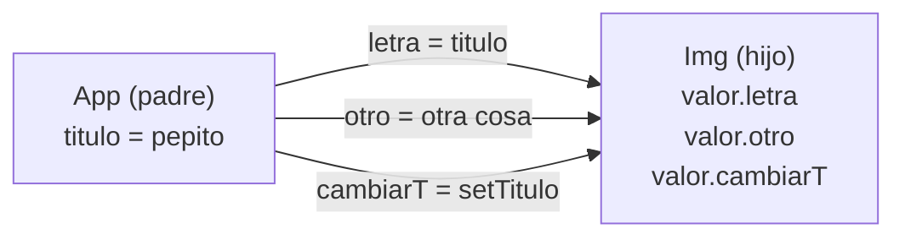

**Importante:** el hijo **no puede modificar** sus props. Son de solo lectura.
**Cuándo usarlo:** siempre que un componente necesite datos de fuera para ser reutilizable (un `Card` que recibe título e imagen).
**Docs:** <https://es.react.dev/learn/passing-props-to-a-component>

---

### 4.4 `useState`: el estado

**Qué es:** una “memoria” del componente. Cuando el estado cambia, **React vuelve a dibujar** el componente con el nuevo valor.

```tsx
const [contador, setContador] = useState(0);
//      valor     función para cambiarlo   valor inicial
```

**¿Por qué no usar una variable normal (`let contador = 0`)?** Porque si cambias una variable normal, React **no se entera** y la pantalla no se actualiza. Además, cada vez que el componente se dibuja, la variable vuelve a 0.

**El ciclo del estado:**

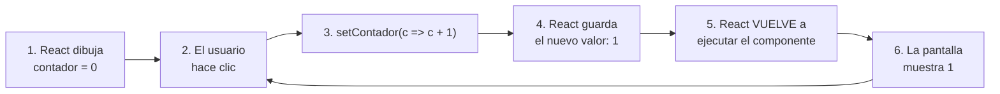

**Variable normal vs `useState`:**

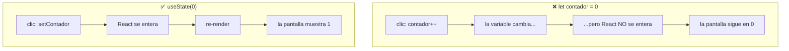

**Actualizar basándote en el valor anterior** (lo que hicimos en clase, es la forma correcta):

```tsx
setContador((contador) => contador + 1);
setMostrar((state) => !state);
```

**Tipar el estado** (TypeScript):

```tsx
const [titulo, setTitulo] = useState<string>("pepito");
```

**Reglas de los hooks** (todo lo que empieza por `use`):
- Solo se llaman **dentro de un componente** (o de otro hook).
- Siempre **arriba del todo**, nunca dentro de un `if`, un `for` o una función interna.

**Cuándo usarlo:** cualquier dato que cambie y que deba verse en pantalla (contador, mostrar/ocultar, texto de un input, lista de tareas...).
**Alternativas:** `useReducer` (para estados complejos), Context API (compartir estado entre muchos componentes), y librerías como Redux o Zustand (la semana que viene veremos Redux).
**Docs:** <https://es.react.dev/reference/react/useState> · <https://es.react.dev/learn/state-a-components-memory>

---

### 4.5 Eventos (`onClick`)

```tsx
<button onClick={() => setContador((c) => c + 1)}>contador +1</button>
```

⚠️ **Error clásico:** escribir `onClick={setContador(contador + 1)}` (sin la flecha). Eso **ejecuta** la función al dibujar, cambia el estado, vuelve a dibujar, la ejecuta otra vez... → **bucle infinito** (“Too many re-renders”).

- `onClick={miFuncion}` → le pasas la función (bien).
- `onClick={() => miFuncion("dato")}` → si necesitas pasar parámetros (bien).
- `onClick={miFuncion("dato")}` → la ejecutas ya (MAL).

**Docs:** <https://es.react.dev/learn/responding-to-events>

---

### 4.6 Renderizado condicional

Mostrar una cosa u otra según una condición. En clase:

```tsx
{mostrar ? <Nombre /> : "Sin nombre"}
```

Otras formas:

```tsx
{mostrar && <Nombre />}          // solo muestra si es true, si no, nada

if (!usuario) return <p>Cargando...</p>;   // salir antes del return principal
```

⚠️ Cuidado con `&&` y números: `{lista.length && <Lista />}` muestra un `0` en pantalla si la lista está vacía. Usa `{lista.length > 0 && <Lista />}`.

**Docs:** <https://es.react.dev/learn/conditional-rendering>

---

### 4.7 Listas con `.map()` (y la `key`)

Convertir un array de datos en un array de elementos JSX:

```tsx
const frutas = [
  { nombre: "pera", color: "verde" },
  { nombre: "manzana", color: "rojo" },
];

{frutas.map((item) => (
  <li key={item.nombre}>{item.nombre} es {item.color}</li>
))}
```

**La `key` es obligatoria.** React la usa para saber qué elemento es cuál cuando la lista cambia (se añade, se borra o se reordena). Si no la pones, la consola muestra un warning.

- La `key` debe ser **única** dentro de la lista y **estable** (lo ideal es un `id`).
- Usar el `index` como key solo está “bien” si la lista nunca cambia de orden ni se borran elementos.
- Si el map devuelve varios elementos con `<> </>`, el fragment corto **no acepta key**. Hay que usar `Fragment`:

```tsx
import { Fragment } from "react";

{frutas.map((item, index) => (
  <Fragment key={item.nombre}>
    <h1>nombre: {item.nombre} {index}</h1>
    <h1>color: {item.color} {index}</h1>
  </Fragment>
))}
```

> 🔎 **Ejercicio rápido:** en `img.component.tsx` el map de frutas **no tiene key**. Abre la consola del navegador (F12), mira el warning, y arréglalo con `Fragment` como arriba.

**Docs:** <https://es.react.dev/learn/rendering-lists>

---

### 4.8 Pasar funciones al hijo (“levantar el estado”)

Las props van de padre a hijo… ¿y si el **hijo** necesita cambiar algo del **padre**? El padre le pasa **la función que cambia su estado**:

```tsx
// App.tsx
const [titulo, setTitulo] = useState("pepito");


// img.component.tsx
<button onClick={() => valor.cambiarT("pepote")}>cambiar nombre</button>
```

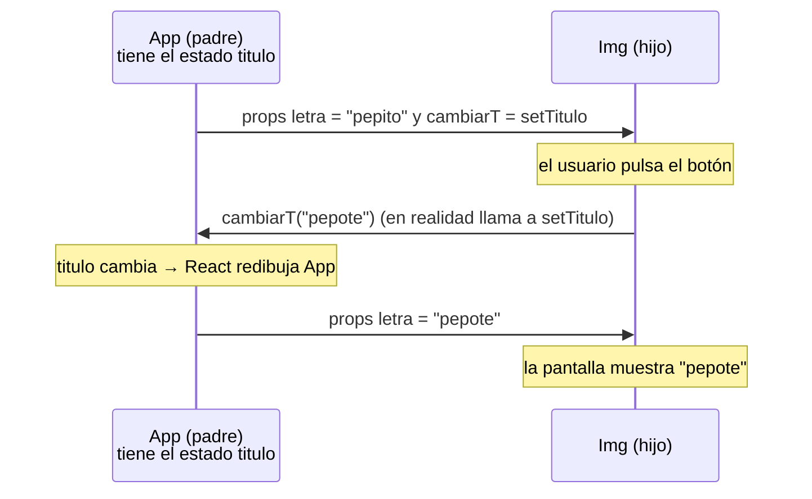

**Los datos bajan por props ⬇️, los avisos suben por funciones ⬆️.**

El estado **vive en el padre**, el hijo solo “pide” que cambie. A esto se le llama **levantar el estado** (lifting state up).

**Cuándo usarlo:** cuando dos componentes hermanos necesitan el mismo dato → lo subes al padre común.
**Cuándo NO alcanza:** cuando tienes que pasar la prop por 4 o 5 niveles (“prop drilling”). Ahí se usa **Context** o **Redux** (próxima clase).
**Docs:** <https://es.react.dev/learn/sharing-state-between-components>

---

### 4.9 Servicios: funciones fuera del componente

```ts
// src/services/funciones.service.ts
export function saludos() {
  return "funcion que te saluda";
}
```

```tsx
import { saludos } from "../services/funciones.service";
<h1>{saludos()}</h1>
```

**Para qué sirve:** separar la **lógica** (cálculos, formateo, más adelante llamadas a APIs con axios) de la **vista** (el JSX). El componente queda más limpio y la función se puede reutilizar y probar sola.
**Cuándo usarlo:** cualquier función que no necesite hooks ni JSX.

#### `export` vs `export default`

```ts
export function saludos() {}   // export con nombre → import { saludos } from "..."
export default App;            // export por defecto → import App from "..."
```

Un archivo puede tener muchos `export` con nombre pero **un solo** `export default`.

---

### 4.10 Imágenes y CSS (Bootstrap)

**Imágenes dentro de `src/assets`:** se importan como si fueran código; Vite les pone la ruta correcta al hacer build.

```tsx
import pc from "./assets/pc.webp";

```

> Imágenes en la carpeta `public/` se usan con ruta absoluta y sin import: ``.

**Bootstrap:** instalado con npm e importado una sola vez en `index.css`:

```css
@import 'bootstrap/dist/css/bootstrap.min.css';
```

Desde ahí puedes usar sus clases en cualquier componente: `className="container"`, `className="btn btn-primary"`, etc.

**Alternativas de estilos:** CSS normal (`App.css`), CSS Modules (`Boton.module.css`), Tailwind CSS, librerías de componentes (React-Bootstrap, Material UI, Chakra, shadcn/ui).
**Docs:** <https://getbootstrap.com/docs/> · <https://vite.dev/guide/assets>

---

### 4.11 React Router: páginas, `Outlet`, `Link`, 404

React crea **SPA** (Single Page Applications): hay **un solo** `index.html`. Cambiar de “página” en realidad es cambiar qué componente se dibuja según la URL. Eso lo hace **React Router**.

**1) Definir las rutas** (`main.tsx`):

```tsx
import { createBrowserRouter } from "react-router";
import { RouterProvider } from "react-router/dom";

const router = createBrowserRouter([
  {
    path: "/",
    Component: App,            // layout: header + footer
    children: [
      { path: "hijo", Component: Hijo },
      { path: "hermano", Component: Hermano },
    ],
  },
  { path: "*", element: <h1>not found</h1> },   // cualquier otra URL → 404
]);

createRoot(document.getElementById("root")!).render(
  <StrictMode>
    <RouterProvider router={router} />
  </StrictMode>
);
```

- `Component: Hijo` → pasas el componente (sin `< />`).
- `element: <h1>...</h1>` → pasas JSX ya escrito. Las dos formas son válidas.
- `path: "*"` → “comodín”: atrapa cualquier ruta que no exista (página 404).
- Sobran los objetos vacíos `{}` que quedaron en el código de clase: **bórralos**, no sirven para nada.

**2) `Outlet`: el hueco donde se dibujan los hijos**

```tsx
// App.tsx
<header>...</header>
<main>
  <Outlet />   {/* aquí aparece Hijo o Hermano según la URL */}
</main>
<footer>...</footer>
```

Así el header y el footer se escriben **una sola vez** y se comparten entre todas las páginas hijas.

Piensa en `App` como un **marco de cuadro** y en el `Outlet` como el **hueco** donde el router cambia la foto según la URL:

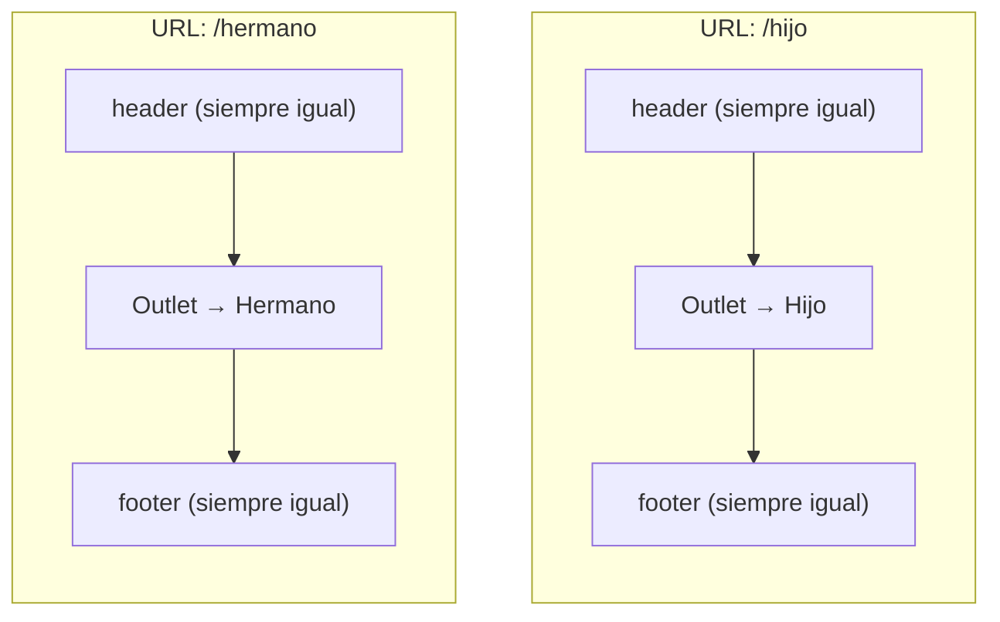

**3) `Link`: navegar sin recargar**

```tsx
<Link to="/hermano">Hermano</Link>
```

¿Por qué no `<a href="/hermano">`? Porque `<a>` **recarga toda la página**: se pierde el estado (el contador vuelve a 0) y es más lento. `Link` cambia la URL y React solo redibuja lo necesario.

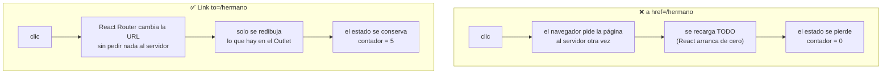

> 🧪 **Pruébalo:** sube el contador a 5, navega con un `Link` → el contador sigue en 5. Ahora cambia ese `Link` por un `<a href>` → el contador vuelve a 0.

**4) Mandar datos “ocultos” al navegar (`state`)**

```tsx
<Link to="/hijo" state={{ estado: "value", algo: "lo que sea" }}>Hijo</Link>
```

Esos datos **no aparecen en la URL** y se leen en el destino con `useLocation()`.

**Alternativas:** TanStack Router; o frameworks que traen rutas incluidas (Next.js, React Router en “modo framework”).
**Docs:** <https://reactrouter.com/home> · <https://reactrouter.com/start/data/routing>

---

### 4.12 `useNavigate`, `useLocation` y `useEffect`: redirecciones

En clase hicimos esto en `hijo.component.tsx`:
**“Si alguien entra a `/hijo` sin pasar por el Link (o sea, sin `state`), mándalo a `/hermano`.”**

```tsx
import { useLocation, useNavigate } from "react-router";
import { useEffect } from "react";

export function Hijo() {
  const navigate = useNavigate();   // función para ir a otra ruta desde código
  const location = useLocation();   // info de la ruta actual (pathname, state...)

  useEffect(() => {
    if (!location.state) {
      navigate("/hermano", { replace: true });
    } else {
      console.log(location.state);
    }
  }, [location.state, navigate]);

  return <h1>Hijo</h1>;
}
```

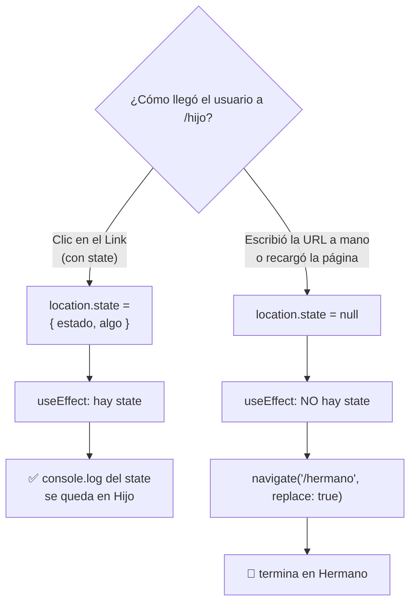

- **`useLocation()`** → devuelve dónde estás: `location.pathname`, `location.state`, `location.search`...
- **`useNavigate()`** → navegar **desde código** (después de un login, al enviar un formulario, si no hay permisos...). `Link` es para cuando el usuario hace clic; `navigate` es para cuando **tu código** decide.
- **`{ replace: true }`** → reemplaza la entrada del historial. Así, si el usuario pulsa “atrás”, no vuelve a la página que lo redirigió (evita un bucle).
- **¿Por qué dentro de `useEffect`?** Porque `navigate` es un **efecto secundario**: no se puede ejecutar mientras React está dibujando. `useEffect` se ejecuta **después** de dibujar.

#### `useEffect` en 30 segundos

```tsx
useEffect(() => {
  // código que se ejecuta DESPUÉS de dibujar
}, [dependencias]);
```

| Array de dependencias | Cuándo se ejecuta |
|---|---|
| `[]` vacío | Una vez, al montar el componente |
| `[a, b]` | Al montar y cada vez que cambie `a` o `b` |
| sin array | Después de **cada** render (casi nunca lo quieres) |

> En desarrollo verás que los `console.log` de un `useEffect` salen **dos veces**. No es un error: es `StrictMode` (ver 4.13).

**Para qué sirve `useEffect`:** sincronizar con cosas de fuera de React: redirecciones, temporizadores, título de la pestaña (`document.title`), y la semana que viene **pedir datos a una API con axios**.
**Alternativas para redirigir:** el componente `<Navigate to="/hermano" replace />` (redirección declarativa en el JSX), o `redirect()` dentro de un `loader` de React Router (más avanzado). Nota: en el código de clase se importó `redirect` pero no se usa; se puede borrar del import.
**Docs:** <https://reactrouter.com/api/hooks/useNavigate> · <https://reactrouter.com/api/hooks/useLocation> · <https://es.react.dev/reference/react/useEffect> · <https://es.react.dev/learn/you-might-not-need-an-effect>

---

### 4.13 `StrictMode`

En `main.tsx` la app va envuelta en `<StrictMode>`. Solo actúa **en desarrollo** (no en el build final): ejecuta algunos componentes y efectos **dos veces** para ayudarte a detectar errores. Por eso ves logs duplicados. **No lo quites**; es tu aliado.
**Docs:** <https://es.react.dev/reference/react/StrictMode>

---

## 5. Cómo romper la app (a propósito) y arreglarla

Aprender a leer errores es **la mitad del trabajo**. Haz cada rotura **de una en una**, observa qué pasa, lee el mensaje, y arréglalo antes de pasar a la siguiente.

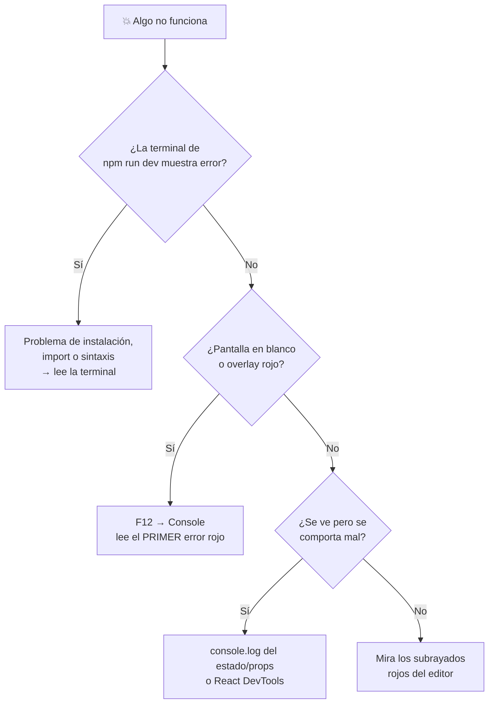

Dónde mirar cuando algo falla:
1. **El navegador** (pantalla en blanco o el overlay rojo de Vite).
2. **La consola del navegador** (`F12` → pestaña *Console*).
3. **La terminal** donde corre `npm run dev`.
4. **El editor** (subrayados rojos de TypeScript).

| # | Rómpelo así | Qué vas a ver | Cómo se arregla | Qué aprendes |
|---|---|---|---|---|
| 1 | Borra la carpeta `node_modules` y ejecuta `npm run dev` | `'vite' no se reconoce...` o `Cannot find module` | `npm install` | `node_modules` se regenera desde `package.json` |
| 2 | En `index.html` cambia `id="root"` por `id="raiz"` | Pantalla en blanco + error en consola (`Target container is not a DOM element`) | Vuelve a poner `root` | `main.tsx` busca ese id exacto |
| 3 | Renombra `function Nombre` a `function nombre` (y su uso a `<nombre />`) | No aparece nada o warning de etiqueta desconocida | Mayúscula inicial | Los componentes empiezan con mayúscula |
| 4 | En un componente devuelve `<h1>A</h1><p>B</p>` sin fragment | Error: *JSX expressions must have one parent element* | Envuelve con `<> </>` | Un solo elemento padre |
| 5 | Quita el `export` de `function Nombre` | `does not provide an export named 'Nombre'` | Vuelve a poner `export` | Lo que no se exporta no se puede importar |
| 6 | Cambia `onClick={() => setContador(c => c + 1)}` por `onClick={setContador(contador + 1)}` | *Too many re-renders* | Vuelve a poner la flecha `() =>` | Pasar la función vs ejecutarla |
| 7 | Cambia el `useState` del contador por `let contador = 0` y en el botón `contador++` | El número **no cambia** en pantalla | Vuelve a `useState` | Solo el estado provoca re-render |
| 8 | En `App.tsx` no pases la prop `otro` a `` | Subrayado rojo en el editor y error en `npm run build` | Pasa la prop o hazla opcional con `?` | La `interface` es un contrato |
| 9 | Mete un `useState` dentro de un `if` | Error de ESLint / de React sobre las reglas de los hooks | Sácalo arriba del todo | Reglas de los hooks |
| 10 | Borra `<Outlet />` de `App.tsx` y navega a `/hijo` | La URL cambia pero **no se ve** el contenido de Hijo | Vuelve a poner `<Outlet />` | Los hijos se dibujan en el Outlet |
| 11 | Usa un `<Link>` en un componente que está **fuera** del `RouterProvider` | Error: *useHref() may be used only in the context of a <Router>* | Todo lo que usa Router debe estar dentro de `RouterProvider` | El router da “contexto” a sus hijos |
| 12 | Escribe a mano en la URL `localhost:5173/hijo` | Te manda a `/hermano` | No es un error: es la redirección funcionando (no hay `state`) | `useLocation` + `useNavigate` |
| 13 | Quita `{ replace: true }` y repite el paso 12, luego pulsa “atrás” | Vuelves a `/hijo`, que te vuelve a mandar a `/hermano`... | Vuelve a poner `replace: true` | Cómo funciona el historial |
| 14 | Borra la ruta `path: "*"` y entra a `/cualquiercosa` | Página de error por defecto de React Router | Vuelve a ponerla | La 404 hay que definirla tú |
| 15 | Quita el `@import` de Bootstrap en `index.css` | Los estilos desaparecen | Vuelve a ponerlo | El CSS hay que importarlo en algún sitio |
| 16 | Escribe mal la ruta de una imagen: `import pc from "./assets/pc.web"` | Error de Vite: *Failed to resolve import* | Corrige la ruta | Lee bien las rutas relativas (`./`, `../`) |

> 💡 **Truco:** si algo se rompe y no sabes qué fue, `Ctrl + Z` en el último archivo que tocaste. Por eso hacemos **paso → prueba**: el error siempre está en lo último que cambiaste.

---

## 6. Documentación oficial

| Tema | Enlace |
|---|---|
| React (en español) – aprender desde cero | <https://es.react.dev/learn> |
| React – referencia de hooks | <https://es.react.dev/reference/react/hooks> |
| React – “Pensar en React” (cómo dividir en componentes) | <https://es.react.dev/learn/thinking-in-react> |
| React Router | <https://reactrouter.com/home> |
| Vite | <https://vite.dev/guide/> |
| TypeScript | <https://www.typescriptlang.org/docs/> |
| TypeScript + React (cheatsheet de la comunidad) | <https://react-typescript-cheatsheet.netlify.app/> |
| Bootstrap | <https://getbootstrap.com/docs/> |
| JavaScript (MDN, en español): `map`, arrow functions, destructuring, módulos | <https://developer.mozilla.org/es/docs/Web/JavaScript> |
| npm | <https://docs.npmjs.com/> |
| Node.js (descarga) | <https://nodejs.org> |

> Extensión recomendada para el navegador: **React Developer Tools** (Chrome/Firefox/Edge). Te deja ver los componentes, sus props y su estado en vivo: <https://es.react.dev/learn/react-developer-tools>

---

## 7. EJERCICIO: Landing page paso a paso

### Objetivo

Construir **desde cero** una landing page para un negocio inventado (una cafetería, un gimnasio, una tienda de videojuegos... **tú eliges**) con:

- Varios **componentes** reutilizables con **props**.
- **Estado** con `useState` y **eventos**.
- **Listas** con `.map()` y `key`.
- **Renderizado condicional**.
- Un **servicio** con funciones.
- **Varias páginas** con React Router, un **layout** compartido y una **página 404**.
- **Redirecciones** con `useNavigate`, `useLocation` y `useEffect`.
- **Bootstrap** para los estilos.

### Así quedará tu app al terminar

**Rutas (páginas):**

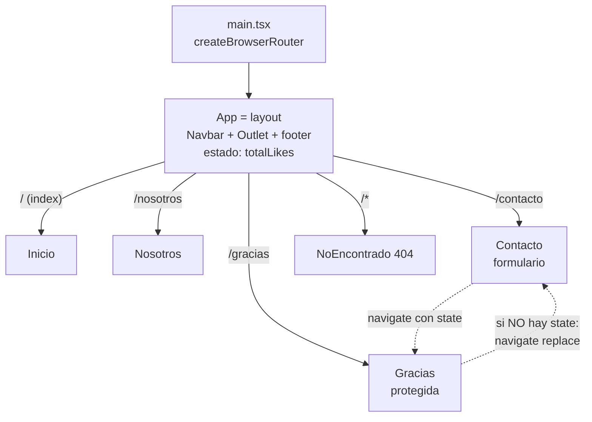

**Componentes de la página de Inicio:**

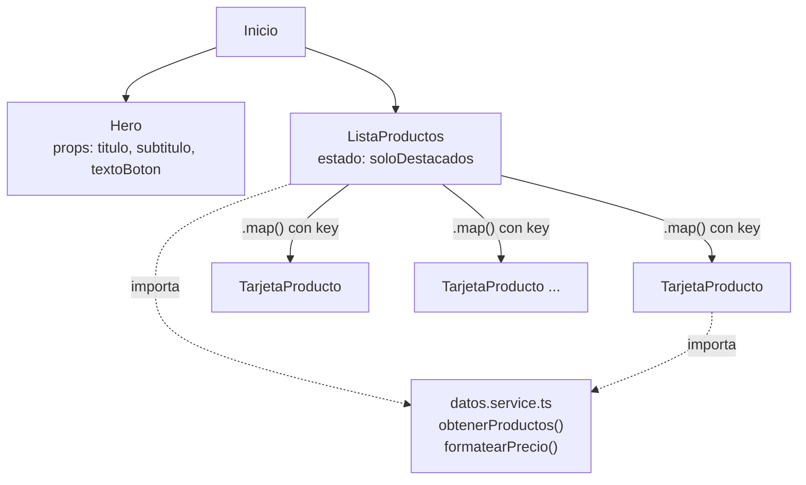

**Orden de los pasos:**

```mermaid
flowchart LR
    P0["0 Crear"] --> P1["1 Limpiar"] --> P2["2 Bootstrap"] --> P3["3 Navbar"] --> P4["4 Hero + props"]
    P4 --> P5["5 Servicio"] --> P6["6 Lista + key"] --> P7["7 useState"] --> P8["8 Levantar estado"]
    P8 --> P9["9 Router + páginas"] --> P10["10 Link"] --> P11["11 Formulario + navigate"] --> P12["12 Página protegida"]
    P12 --> P13["13 Botón Hero"] --> P14["14 lint + build"]
```

### ⚠️ Reglas del ejercicio

1. Cada paso termina con un bloque **✅ PRUEBA**. **Está PROHIBIDO pasar al siguiente paso si la prueba no funciona.**
2. Ten **siempre abierta la consola del navegador (F12)**. Un paso solo está bien si la consola **no tiene errores rojos**.
3. Si un paso tiene un bloque **💥 ROMPE Y ARREGLA**, hazlo. Es parte del ejercicio.
4. Haz un **commit** cada vez que una prueba salga bien. Si te pierdes, puedes volver atrás.
   ```bash
   git add .
   git commit -m "paso X: descripción"
   ```

---

### Paso 0 — Crear el proyecto

Fuera de la carpeta de este repositorio:

```bash
npm create vite@latest mi-landing -- --template react-ts
cd mi-landing
npm install
npm run dev
```

**¿Por qué?** `create vite` genera el esqueleto; `npm install` descarga React y compañía; `npm run dev` levanta el servidor.

**✅ PRUEBA:** abre `http://localhost:5173`. Ves la página de bienvenida de Vite + React. Pulsa el botón del contador: sube.

---

### Paso 1 — Limpiar el proyecto

Deja `src/App.tsx` así:

```tsx
function App() {
  return <h1>Mi landing</h1>;
}

export default App;
```

Vacía el contenido de `src/App.css` y `src/index.css` (déjalos en blanco, no los borres).

**✅ PRUEBA:** el navegador se actualiza **solo** (eso es el HMR de Vite) y ves únicamente “Mi landing”. La consola está limpia.

---

### Paso 2 — Instalar Bootstrap

```bash
npm install bootstrap
```

**¿Por qué?** Para tener estilos listos sin escribir CSS. Se instala con npm (en vez de un `<link>` a un CDN) para que la versión quede fijada en `package.json` y todo el equipo use la misma.

En `src/index.css`:

```css
@import 'bootstrap/dist/css/bootstrap.min.css';
```

En `App.tsx` cambia el h1 por: `<h1 className="text-primary text-center">Mi landing</h1>`

**✅ PRUEBA:** el título está centrado y en azul. Abre `package.json` y comprueba que `bootstrap` aparece en `dependencies`.

**💥 ROMPE Y ARREGLA:** comenta el `@import` → el título pierde el estilo. Descomenta → vuelve.

---

### Paso 3 — Primer componente: `Navbar`

Crea `src/components/Navbar.tsx`:

```tsx
export function Navbar() {
  return (
    <nav className="navbar navbar-dark bg-dark px-3">
      <span className="navbar-brand">☕ Mi Cafetería</span>
    </nav>
  );
}
```

Úsalo en `App.tsx`:

```tsx
import { Navbar } from "./components/Navbar";

function App() {
  return (
    <>
      <Navbar />
      <h1 className="text-primary text-center">Mi landing</h1>
    </>
  );
}
```

**✅ PRUEBA:** aparece una barra negra arriba con el nombre del negocio.

**💥 ROMPE Y ARREGLA:**
- Quita el `<> </>` → error *“must have one parent element”*. Vuelve a ponerlo.
- Cambia el import a `import { navbar } ...` → error de export. Arréglalo.

---

### Paso 4 — Componente con props: `Hero`

El “hero” es el bloque grande de presentación de una landing.

Crea `src/components/Hero.tsx`:

```tsx
interface HeroProps {
  titulo: string;
  subtitulo: string;
  textoBoton?: string;   // opcional
}

export function Hero({ titulo, subtitulo, textoBoton = "Saber más" }: HeroProps) {
  return (
    <section className="container text-center py-5">
      <h1 className="display-4">{titulo}</h1>
      <p className="lead">{subtitulo}</p>
      <button className="btn btn-primary">{textoBoton}</button>
    </section>
  );
}
```

En `App.tsx` reemplaza el `<h1>` por:

```tsx
<Hero titulo="El mejor café de la ciudad" subtitulo="Tostado aquí, cada mañana" />
```

**✅ PRUEBA:** ves el título, el subtítulo y un botón que dice “Saber más” (el valor por defecto). Ahora pásale `textoBoton="Ver carta"` → el botón cambia.

**💥 ROMPE Y ARREGLA:** quita la prop `subtitulo` en `App.tsx` → el editor lo subraya en rojo. Ejecuta `npm run build` en otra terminal → falla. Vuelve a ponerla y el build pasa. **Conclusión: TypeScript te protege de olvidos.**

---

### Paso 5 — Un servicio con datos y funciones

Crea `src/services/datos.service.ts`:

```ts
export interface Producto {
  id: number;
  nombre: string;
  precio: number;
  destacado: boolean;
}

export function obtenerProductos(): Producto[] {
  return [
    { id: 1, nombre: "Espresso", precio: 1.5, destacado: true },
    { id: 2, nombre: "Capuchino", precio: 2.3, destacado: false },
    { id: 3, nombre: "Latte", precio: 2.5, destacado: true },
    { id: 4, nombre: "Tarta de queso", precio: 3.9, destacado: false },
  ];
}

export function formatearPrecio(precio: number): string {
  return precio.toFixed(2) + " €";
}
```

**¿Por qué en un servicio?** Porque hoy los datos están “escritos a mano”, pero la semana que viene vendrán de una API con axios. Si ya están separados, solo cambiarás **este archivo**, no los componentes.

**✅ PRUEBA:** de momento, en `App.tsx` importa `formatearPrecio` y escribe `<p>{formatearPrecio(2)}</p>`. Debe mostrar `2.00 €`. Después borra esa línea de prueba.

---

### Paso 6 — Lista con `.map()` y `key`: `TarjetaProducto` + `ListaProductos`

Crea `src/components/TarjetaProducto.tsx`:

```tsx
import { formatearPrecio, type Producto } from "../services/datos.service";

interface Props {
  producto: Producto;
}

export function TarjetaProducto({ producto }: Props) {
  return (
    <div className="col-md-3">
      <div className="card h-100">
        <div className="card-body">
          <h5 className="card-title">{producto.nombre}</h5>
          <p className="card-text">{formatearPrecio(producto.precio)}</p>
          {producto.destacado && <span className="badge bg-warning text-dark">⭐ Destacado</span>}
        </div>
      </div>
    </div>
  );
}
```

Crea `src/components/ListaProductos.tsx`:

```tsx
import { obtenerProductos } from "../services/datos.service";
import { TarjetaProducto } from "./TarjetaProducto";

export function ListaProductos() {
  const productos = obtenerProductos();

  return (
    <section className="container py-4">
      <h2 className="mb-3">Nuestra carta</h2>
      <div className="row g-3">
        {productos.map((p) => (
          <TarjetaProducto key={p.id} producto={p} />
        ))}
      </div>
    </section>
  );
}
```

Añade `<ListaProductos />` debajo del `<Hero />` en `App.tsx`.

**✅ PRUEBA:** ves 4 tarjetas en fila (en pantalla grande) con nombre y precio; las destacadas tienen la etiqueta ⭐ (eso es **renderizado condicional** con `&&`). Haz la ventana estrecha: las tarjetas se apilan (grid de Bootstrap).

**💥 ROMPE Y ARREGLA:** quita `key={p.id}` → en la consola aparece *“Each child in a list should have a unique key prop”*. Vuelve a ponerla y el warning desaparece.

**🧩 Reto opcional:** añade un producto nuevo en el servicio → aparece solo, **sin tocar ningún componente**.

---

### Paso 7 — Estado y eventos: filtrar destacados

Vamos a añadir un botón que alterne entre “ver todos” y “ver solo destacados”. Modifica `ListaProductos.tsx`:

```tsx
import { useState } from "react";
import { obtenerProductos } from "../services/datos.service";
import { TarjetaProducto } from "./TarjetaProducto";

export function ListaProductos() {
  const [soloDestacados, setSoloDestacados] = useState(false);
  const productos = obtenerProductos();

  const visibles = soloDestacados
    ? productos.filter((p) => p.destacado)
    : productos;

  return (
    <section className="container py-4">
      <h2 className="mb-3">Nuestra carta</h2>

      <button
        className="btn btn-outline-dark mb-3"
        onClick={() => setSoloDestacados((estado) => !estado)}
      >
        {soloDestacados ? "Ver todos" : "Ver solo destacados"}
      </button>

      <div className="row g-3">
        {visibles.map((p) => (
          <TarjetaProducto key={p.id} producto={p} />
        ))}
      </div>
    </section>
  );
}
```

**✅ PRUEBA:** pulsa el botón → solo quedan los destacados y el texto del botón cambia. Pulsa otra vez → vuelven todos.

**💥 ROMPE Y ARREGLA:**
1. Cambia el `onClick` por `onClick={setSoloDestacados(!soloDestacados)}` → pantalla en blanco y *“Too many re-renders”* en consola. Explica con tus palabras **por qué** y arréglalo.
2. Cambia el `useState` por `let soloDestacados = false` y en el click `soloDestacados = !soloDestacados` → el botón “no hace nada”. ¿Por qué? Vuelve a `useState`.

---

### Paso 8 — Levantar el estado: contador de “Me gusta” en el padre

Queremos que cada tarjeta tenga un botón ❤️ y que el **Navbar** muestre el total de “me gusta”. Navbar y ListaProductos son **hermanos**, así que el estado tiene que vivir en el **padre** (`App`).

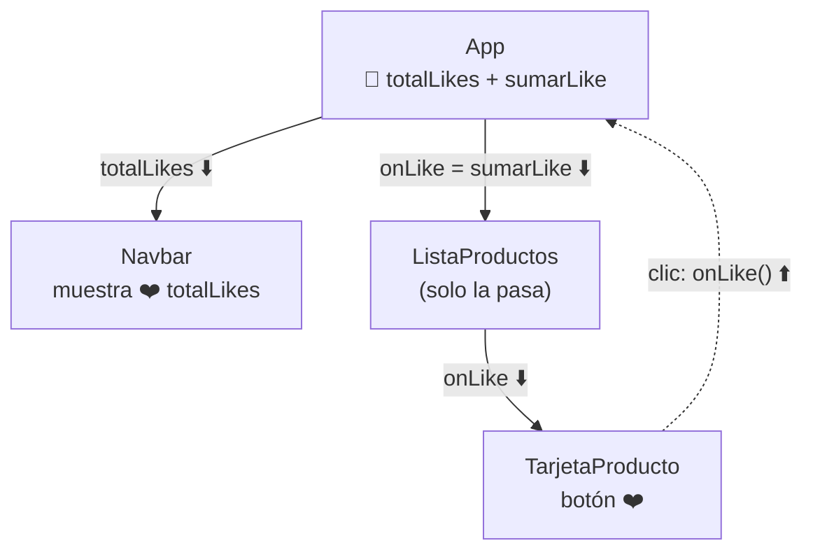

> Fíjate: `ListaProductos` no usa `onLike` para nada, solo **lo pasa** hacia abajo. Eso es el *prop drilling*.

En `App.tsx`:

```tsx
const [totalLikes, setTotalLikes] = useState(0);

function sumarLike() {
  setTotalLikes((total) => total + 1);
}

// ...
<Navbar totalLikes={totalLikes} />
<Hero ... />
<ListaProductos onLike={sumarLike} />
```

En `Navbar.tsx` recibe `totalLikes: number` por props y muéstralo: `<span className="text-white">❤️ {totalLikes}</span>`.

En `ListaProductos.tsx` recibe `onLike: () => void` y pásaselo a cada `TarjetaProducto`.
En `TarjetaProducto.tsx` recibe `onLike` y añade:

```tsx
<button className="btn btn-sm btn-outline-danger" onClick={onLike}>❤️</button>
```

(No olvides añadir las nuevas props a cada `interface`.)

**✅ PRUEBA:** pulsa ❤️ en cualquier tarjeta → el número del Navbar sube.

**💥 ROMPE Y ARREGLA:** olvida pasar `onLike` desde `ListaProductos` a `TarjetaProducto` → TypeScript te avisa. Fíjate en cuántos niveles tuviste que pasar la prop: eso se llama **prop drilling** y es justo el problema que resuelve **Redux** (la próxima clase).

---

### Paso 9 — Instalar React Router y crear páginas

```bash
npm install react-router
```

**¿Por qué?** React no sabe nada de URLs. Sin router, toda la app es una sola “pantalla”.

**9.1 — Crea la carpeta `src/pages/`** con estos archivos:

`src/pages/Inicio.tsx` → mueve aquí el `Hero` y `ListaProductos`:

```tsx
import { Hero } from "../components/Hero";
import { ListaProductos } from "../components/ListaProductos";

export function Inicio() {
  return (
    <>
      <Hero titulo="El mejor café de la ciudad" subtitulo="Tostado aquí, cada mañana" />
      <ListaProductos onLike={() => {}} />
    </>
  );
}
```

> De momento `onLike` hace nada (`() => {}`). En el paso 9.4 lo reconectamos.

`src/pages/Nosotros.tsx`:

```tsx
export function Nosotros() {
  return (
    <section className="container py-5">
      <h1>Sobre nosotros</h1>
      <p>Somos una cafetería de barrio desde 1999.</p>
    </section>
  );
}
```

`src/pages/NoEncontrado.tsx`:

```tsx
export function NoEncontrado() {
  return (
    <section className="container py-5 text-center">
      <h1>404</h1>
      <p>Esta página no existe.</p>
    </section>
  );
}
```

**9.2 — Convierte `App` en el layout** (`App.tsx`):

```tsx
import { useState } from "react";
import { Outlet } from "react-router";
import { Navbar } from "./components/Navbar";

function App() {
  const [totalLikes, setTotalLikes] = useState(0);

  return (
    <>
      <Navbar totalLikes={totalLikes} />
      <main>
        <Outlet />
      </main>
      <footer className="bg-dark text-white text-center py-3 mt-5">
        © 2026 Mi Cafetería
      </footer>
    </>
  );
}

export default App;
```

> `setTotalLikes` queda sin usar por ahora; lo usamos en 9.4.

**9.3 — Define las rutas en `main.tsx`:**

```tsx
import { StrictMode } from "react";
import { createRoot } from "react-dom/client";
import { createBrowserRouter } from "react-router";
import { RouterProvider } from "react-router/dom";
import "./index.css";
import App from "./App.tsx";
import { Inicio } from "./pages/Inicio.tsx";
import { Nosotros } from "./pages/Nosotros.tsx";
import { NoEncontrado } from "./pages/NoEncontrado.tsx";

const router = createBrowserRouter([
  {
    path: "/",
    Component: App,
    children: [
      { index: true, Component: Inicio },     // index: true → se muestra en "/"
      { path: "nosotros", Component: Nosotros },
      { path: "*", Component: NoEncontrado },
    ],
  },
]);

createRoot(document.getElementById("root")!).render(
  <StrictMode>
    <RouterProvider router={router} />
  </StrictMode>
);
```

> Fíjate: aquí la 404 está **dentro** de `children`, así **conserva el Navbar y el footer**. En la clase la pusimos fuera, por eso salía sola.

**✅ PRUEBA (escribe las URLs a mano en el navegador):**
- `localhost:5173/` → Navbar + Hero + carta + footer.
- `localhost:5173/nosotros` → Navbar + “Sobre nosotros” + footer.
- `localhost:5173/loquesea` → Navbar + 404 + footer.

**💥 ROMPE Y ARREGLA:** borra `<Outlet />` de `App.tsx` → en todas las URLs solo ves Navbar y footer. Vuelve a ponerlo.

**9.4 — Reconectar los likes con `useOutletContext`** (un pasito más, opcional pero recomendado):
El `Outlet` puede pasar datos a las páginas hijas:

```tsx
// App.tsx
<Outlet context={{ sumarLike: () => setTotalLikes((t) => t + 1) }} />
```

```tsx
// Inicio.tsx
import { useOutletContext } from "react-router";

const { sumarLike } = useOutletContext<{ sumarLike: () => void }>();
// ...
<ListaProductos onLike={sumarLike} />
```

**✅ PRUEBA:** los ❤️ vuelven a sumar en el Navbar.
Docs: <https://reactrouter.com/api/hooks/useOutletContext>

---

### Paso 10 — Navegar con `Link`

En `Navbar.tsx`:

```tsx
import { Link } from "react-router";

// dentro del nav:
<Link className="navbar-brand" to="/">☕ Mi Cafetería</Link>
<div className="d-flex gap-3">
  <Link className="nav-link text-white" to="/">Inicio</Link>
  <Link className="nav-link text-white" to="/nosotros">Nosotros</Link>
  <Link className="nav-link text-white" to="/contacto">Contacto</Link>
</div>
```

**✅ PRUEBA:**
1. Da 3 likes. Navega a “Nosotros” y vuelve a “Inicio” con los links → **el contador sigue en 3**.
2. “Contacto” aún no existe → debe mostrar tu 404 (correcto por ahora).

**💥 ROMPE Y ARREGLA:** cambia un `Link` por `<a href="/nosotros">`. Da 3 likes y navega con él → **el contador vuelve a 0** y notarás que la página parpadea (recarga completa). Vuelve a `Link`.

> 🧩 **Reto opcional:** usa `NavLink` en vez de `Link` para que el enlace de la página actual se vea resaltado. Docs: <https://reactrouter.com/api/components/NavLink>

---

### Paso 11 — Formulario de contacto + redirección con `useNavigate`

Crea `src/pages/Contacto.tsx`:

```tsx
import { useState } from "react";
import { useNavigate } from "react-router";

export function Contacto() {
  const [nombre, setNombre] = useState("");
  const navigate = useNavigate();

  function enviar(e: React.FormEvent) {
    e.preventDefault();          // evita que el formulario recargue la página
    if (nombre.trim() === "") return;
    navigate("/gracias", { state: { nombre } });
  }

  return (
    <section className="container py-5" style={{ maxWidth: 500 }}>
      <h1>Contacto</h1>
      <form onSubmit={enviar}>
        <input
          className="form-control mb-3"
          placeholder="Tu nombre"
          value={nombre}
          onChange={(e) => setNombre(e.target.value)}
        />
        <button className="btn btn-primary" disabled={nombre.trim() === ""}>
          Enviar
        </button>
      </form>
    </section>
  );
}
```

> **Nuevo (pero es lo mismo que ya sabes):** el `input` guarda lo que escribes en un `useState` gracias a `onChange`. Esto se llama **input controlado**: React es quien manda sobre el valor del input.

Añade la ruta en `main.tsx` (dentro de `children`, **antes** del `*`):

```tsx
{ path: "contacto", Component: Contacto },
```

**✅ PRUEBA:**
- Entra en “Contacto” desde el Navbar.
- Con el input vacío, el botón está deshabilitado.
- Escribe tu nombre → el botón se habilita.
- Pulsa “Enviar” → te lleva a `/gracias`… que de momento es la 404. **Correcto**, lo hacemos en el siguiente paso.

**💥 ROMPE Y ARREGLA:** quita `e.preventDefault()` → al enviar, la página **se recarga entera** y pierdes el estado. Vuelve a ponerlo.

---

### Paso 12 — Página protegida con `useLocation` + `useEffect`

`/gracias` solo tiene sentido si vienes del formulario. Si alguien escribe la URL a mano, lo mandamos a `/contacto`. (Es exactamente lo que hicimos en clase con `Hijo` → `Hermano`.)

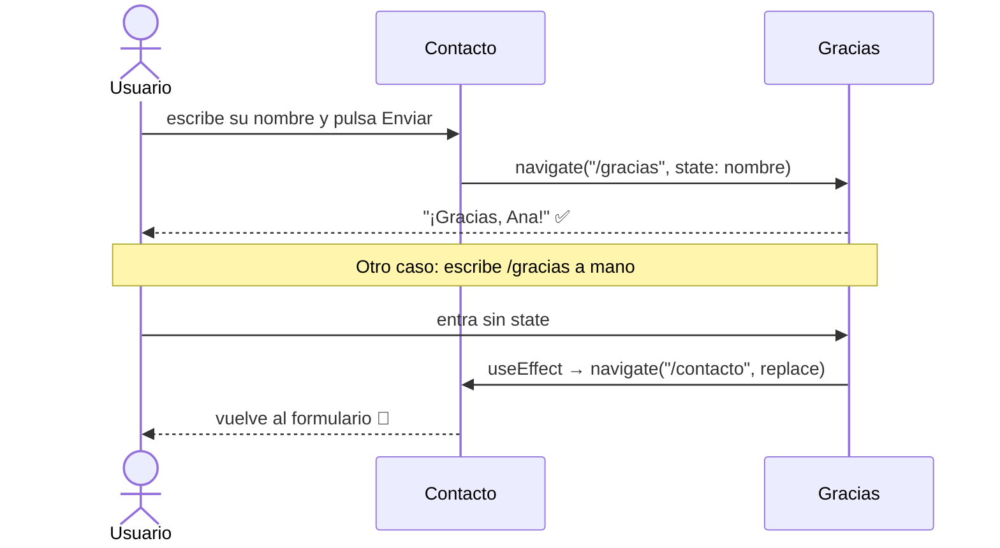

Crea `src/pages/Gracias.tsx`:

```tsx
import { useEffect } from "react";
import { useLocation, useNavigate } from "react-router";

export function Gracias() {
  const location = useLocation();
  const navigate = useNavigate();
  const nombre = location.state?.nombre;

  useEffect(() => {
    if (!nombre) {
      navigate("/contacto", { replace: true });
    }
  }, [nombre, navigate]);

  if (!nombre) return null;   // no dibujes nada mientras redirige

  return (
    <section className="container py-5 text-center">
      <h1>¡Gracias, {nombre}! ☕</h1>
      <p>Te contestaremos muy pronto.</p>
    </section>
  );
}
```

Añade la ruta `{ path: "gracias", Component: Gracias }` en `main.tsx`.

**✅ PRUEBA:**
1. Rellena el formulario y envía → ves “¡Gracias, TuNombre!”.
2. Escribe a mano `localhost:5173/gracias` → te **redirige** a `/contacto`.
3. Después del paso 2, pulsa “atrás” en el navegador → **no** te quedas atrapado en un bucle (gracias a `replace: true`).

**💥 ROMPE Y ARREGLA:**
- Quita `{ replace: true }` y repite la prueba 3 → observa la diferencia en el historial. Vuelve a ponerlo.
- Saca el `navigate(...)` fuera del `useEffect` (directamente en el cuerpo del componente) → React muestra un warning en consola (*“You should call navigate() in a React.useEffect()”*). Vuelve a meterlo en el `useEffect`.

> 🧩 **Reto opcional:** en vez de `useEffect` + `navigate`, prueba la versión declarativa:
> ```tsx
> import { Navigate } from "react-router";
> if (!nombre) return <Navigate to="/contacto" replace />;
> ```
> Las dos funcionan. ¿Cuál te parece más fácil de leer?

---

### Paso 13 — Botón del Hero que redirige

Haz que el botón del `Hero` lleve a `/contacto` usando `useNavigate` dentro del componente `Hero` (pista: `onClick={() => navigate("/contacto")}`).

**✅ PRUEBA:** pulsa el botón del Hero → vas a Contacto.

**Pregunta para pensar:** ¿cuándo usarías un `Link` y cuándo `navigate`?
(Respuesta: `Link` cuando es un enlace que el usuario pulsa; `navigate` cuando la navegación depende de la lógica: después de enviar un formulario, de validar algo, de un login...)

---

### Paso 14 — Comprobación final

```bash
npm run lint
npm run build
npm run preview
```

**✅ PRUEBA:**
- `lint` no muestra errores (si muestra, léelos y corrígelos).
- `build` termina sin errores de TypeScript y crea la carpeta `dist/`.
- `preview` abre la versión final: recorre **todas** las páginas otra vez.

---

### Retos extra (para quien termine)

1. Página `/producto/:id` que muestre el detalle de un producto. Pista: `useParams()` → <https://reactrouter.com/api/hooks/useParams>
2. Botón “modo oscuro” con `useState` en `App` que cambie las clases de Bootstrap (`bg-dark`/`bg-light`).
3. Un `useEffect` que cambie el título de la pestaña según la página: `document.title = "Contacto | Mi Cafetería"`.
4. Componente `Footer` aparte, con props para el año y el nombre del negocio.

---

## 8. Checklist de entrega

Marca cada punto antes de entregar:

- [ ] El proyecto arranca con `npm install` + `npm run dev` en un ordenador limpio.
- [ ] `node_modules` **no** está subido a GitHub (revisa el `.gitignore`).
- [ ] Hay al menos 4 componentes en `src/components/` y 4 páginas en `src/pages/`.
- [ ] Al menos un componente recibe props tipadas con `interface`.
- [ ] Hay al menos un `useState` con un evento `onClick`.
- [ ] Hay una lista hecha con `.map()` y cada elemento tiene `key`.
- [ ] Hay renderizado condicional (`? :` o `&&`).
- [ ] Hay un estado que vive en el padre y se modifica desde un hijo.
- [ ] Hay un archivo en `src/services/` con funciones reutilizables.
- [ ] Hay layout con `Outlet`, navegación con `Link` y página 404.
- [ ] Hay una redirección con `useNavigate` y otra protegida con `useLocation` + `useEffect`.
- [ ] La consola del navegador no tiene errores rojos ni warnings de `key`.
- [ ] `npm run build` termina sin errores.
- [ ] Hay un commit por paso (mínimo 10 commits).

---

### Lo que viene la próxima semana

- **axios**: pedir datos reales a una API (reemplazará los datos “a mano” de `datos.service.ts`).
- **Redux**: estado global, para dejar de pasar props por 4 niveles (el “prop drilling” que sufriste en el paso 8).
- **Middleware**.

¡A practicar! **Paso → prueba → paso → prueba.** 🚀
